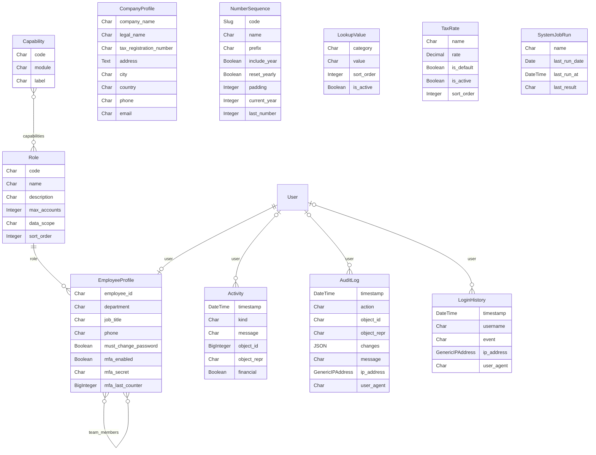
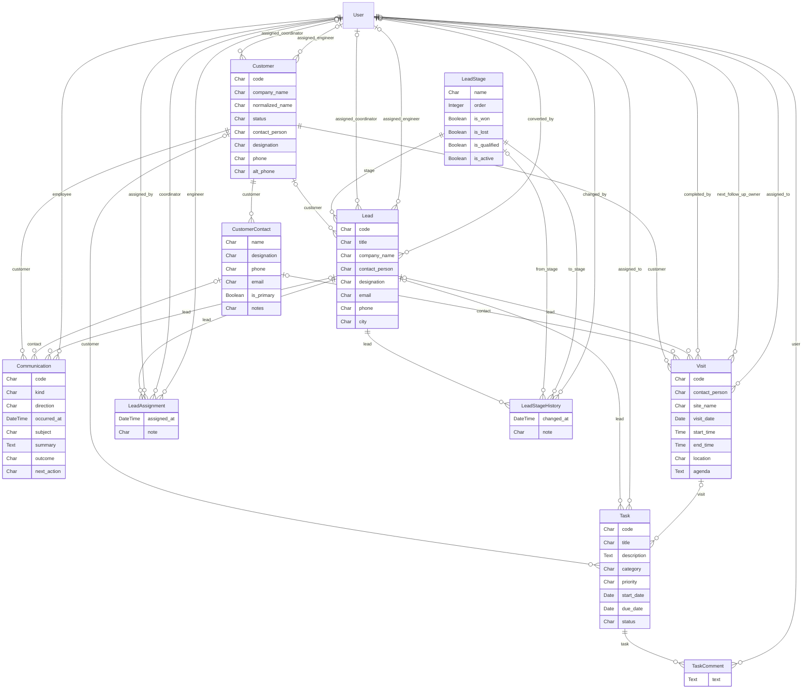
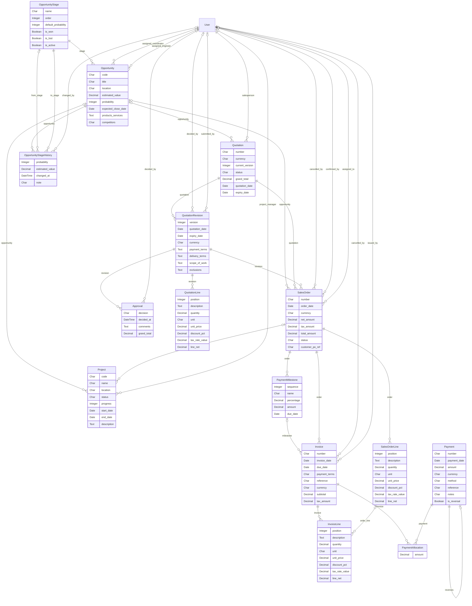
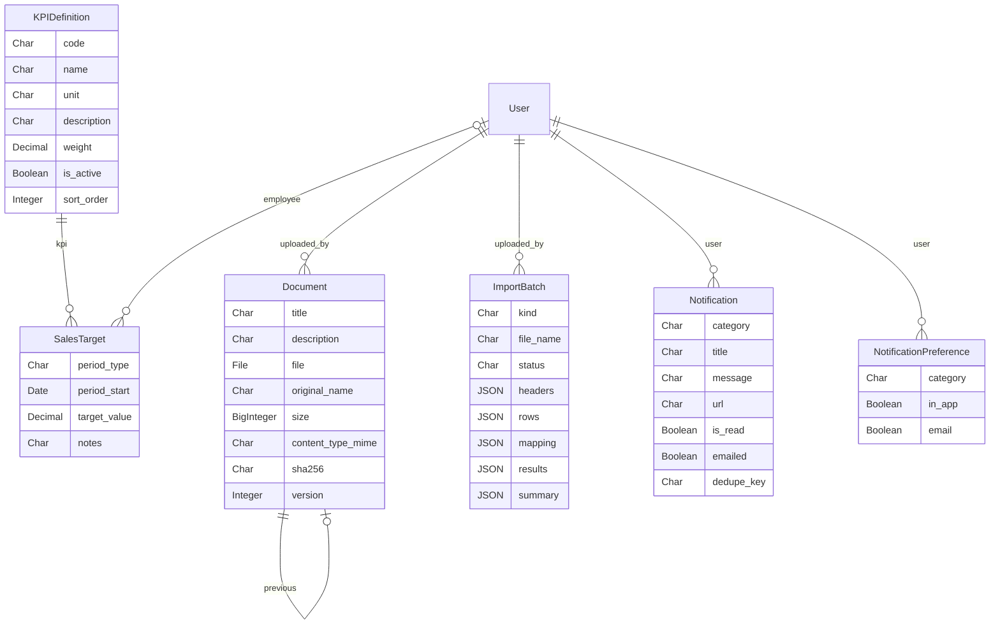

# Technoflow CRM — Database

PostgreSQL in production (SQLite only for development and tests). Tables are created by Django migrations
(`python manage.py migrate`); never edit the structure by hand.

## Rules built into the data model

- **Money** is stored as `NUMERIC(14,2)` (Decimal), never floating point. All calculations go through
  `core/money.py`, and dashboards/reports through `reporting/metrics.py`, so figures are the same everywhere.
- **Quotation revisions** are separate rows. A submitted, approved or sent revision is locked: its lines and
  financial fields cannot be changed (enforced in the model `save()`); changes create a new revision.
- **Invoices** get their number only when issued, from `NumberSequence` with a row lock (no gaps, no duplicates).
  Issued invoices' amounts are locked.
- **Payments are never updated or deleted.** A reversal is a new payment row with `is_reversal=True` pointing at
  the original; allocations are `PaymentAllocation` rows (a database constraint forbids zero amounts).
- **Audit log** (`core_auditlog`) is append-only and records changed fields with before/after values for every
  tracked business table; `core_activity` is the business timeline shown on record pages.
- **Deletes** use `PROTECT` on business links: a customer with quotations, orders or invoices cannot be deleted
  (archive it instead).
- **Documents** keep only metadata in the database; files are stored in the private `MEDIA_ROOT` folder under
  random names, with a SHA-256 checksum. New versions point to the previous one (`previous`, `is_current`).
- **Ownership / scope**: records carry `assigned_engineer` / `assigned_coordinator` / `salesperson` /
  `assigned_to`; the role's data scope filters on these fields everywhere.
- Every business table has `created_at`, `created_by`, `updated_at`, `updated_by` (omitted from the diagrams).

## Main tables

| Area | Tables |
| --- | --- |
| Users & security | `auth_user`, `accounts_employeeprofile` (role, manager, team, MFA), `accounts_role`, `accounts_capability`, `accounts_loginhistory`, `axes_*` |
| Settings | `core_companyprofile` (single row), `core_numbersequence`, `core_lookupvalue`, `core_taxrate`, `core_systemjobrun` |
| Audit & timeline | `core_auditlog`, `core_activity` |
| Customers | `customers_customer`, `customers_customercontact` |
| Leads | `leads_leadstage`, `leads_lead`, `leads_leadassignment`, `leads_leadstagehistory` |
| Activity | `visits_visit`, `communications_communication`, `tasks_task`, `tasks_taskcomment` |
| Pipeline | `sales_opportunitystage`, `sales_opportunity`, `sales_opportunitystagehistory`, `sales_project` |
| Quotations | `quotations_quotation`, `quotations_quotationrevision`, `quotations_quotationline`, `quotations_approval` |
| Orders | `orders_salesorder`, `orders_salesorderline`, `orders_paymentmilestone` |
| Finance | `invoicing_invoice`, `invoicing_invoiceline`, `invoicing_payment`, `invoicing_paymentallocation` |
| Performance | `performance_kpidefinition`, `performance_salestarget` |
| Documents | `documents_document` |
| Notifications | `notifications_notification`, `notifications_notificationpreference` |
| Import | `reporting_importbatch` |

## Entity-relationship diagrams

Generated from the models (key fields only; GitHub renders these diagrams).

### Users, settings and audit

### Customers, leads and activity

### Pipeline, quotations, orders and finance

### Targets, documents, notifications, imports

